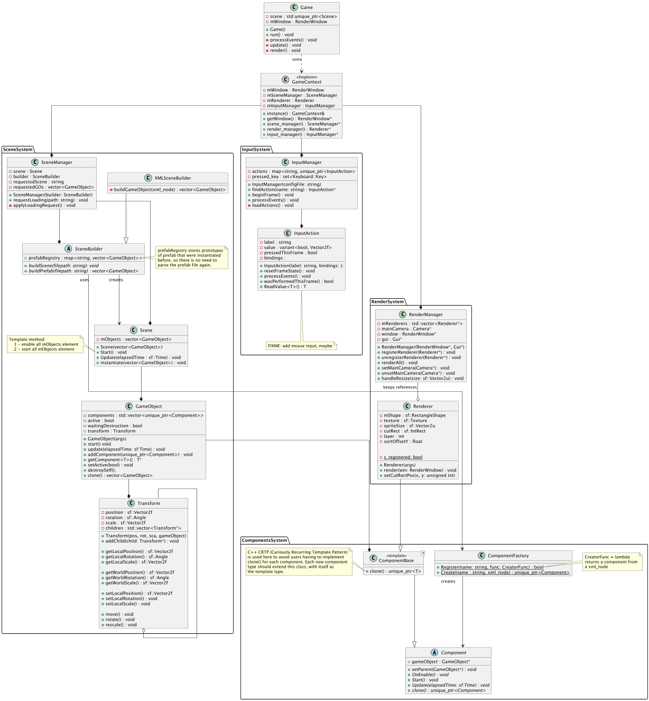

---
header-includes:
  - \usepackage[english]{babel}
  - \usepackage[en-GB]{datetime2}
  - \usepackage{fancyhdr}
  - \usepackage{float}
  - \usepackage[T1]{fontenc}
  - \usepackage[includehead,headheight=40pt,top=1.5cm,left=2.5cm,bottom=2.5cm,right=2.5cm,headsep=0.5cm]{geometry}
  - \usepackage{graphicx}
  - \usepackage{inconsolata}
  - \usepackage[utf8]{inputenc}
  - \usepackage{sectsty}
  - \usepackage{setspace}
  - \usepackage{xcolor}
  - \setstretch{1.2}
  - \pagestyle{fancy}
  - \fancyhf{}
  - \fancyhead[L]{6II0025 Design Patterns}
  - \fancyhead[R]{\includegraphics[height=40pt]{img/doc-header-img-en.jpg}}
  - \fancyfoot[C]{\thepage}
  - \definecolor{DarkBlue}{RGB}{0,45,114}
  - \sectionfont{\color{DarkBlue}\rmfamily}
  - \subsectionfont{\color{DarkBlue}\rmfamily}
  - \subsubsectionfont{\color{DarkBlue}\rmfamily}
  - \renewcommand{\familydefault}{\sfdefault}
  - \renewcommand{\ttdefault}{zi4}
---


\begin{titlepage}
\centering
\begin{figure}[H]
\centering
\includegraphics[width=0.5\textwidth]{img/doc-title-en.jpg}
\end{figure}
\bigskip
{\LARGE Design Patterns \\}
{\large Semestral Project \\}
\bigskip
{\large First Name Last Name \\}
\end{titlepage}


\clearpage

\tableofcontents

\clearpage


\clearpage
*This template uses the [Pandoc markdown](https://garrettgman.github.io/rmarkdown/authoring_pandoc_markdown.html)*
*format. The linked page contains documentation on formatting the various parts*
*of the document.  The template includes an example of the basic formatting that*
*is sufficient for writing your documentation. Do not change the structure of the*
*document (sections and subsections).  Remove all text formatted in italics after*
*using the template. On the title page defined above, change the author's name*
*only; do not modify the other parts.*


# Problem Description
The project is a simple 2D Game Engine inspired by the "way of coding" of Unity. 
It uses XML (instead of graphical interface in Unity) to design scenes, premade gameObjects and animation trees.
The main goal is to assemble scene and gameObjects in XML and program only components to give those objects specific behaviors.


\clearpage
# General Design

{ width=40% }


\clearpage
# Design Patterns
The following design patterns are used in the semestral project:
- Dependency Injection
- Builder / Abstract Factory
- Prototype
- Template Method
- Observer
- Composite
- FlyWeight

*For each design pattern, describe what problem it solved in your project and why*
*it is suitable for that problem (why you did not use another -- alternative --*
*design pattern). Use UML diagrams and/or source code samples that show how the*
*pattern is used in the application.*


## Creational
### Dependency Injection
Self registration of Components classes to the Component Factory. 
(see any component class and [ComponentFactory.h](../src/engine/Managers/Scene/ComponentFactory.h))

### Builder / AbstractFactory
The current scene building system has a huge dependency to XML and it mixes game update logic 
and loading from xml logic. 
I need to use an interface/abstract class SceneBuilder that is realised by specific
implementation (XMLSceneBuilder, JsonSceneBuilder f.e.)
Then use the builder to build a new Scene object. 

Also GameObjects are complex objects, with lot of attributes etc.
So the Builder patter may be useful inside the factory.

### Prototype
A premade gameObject template must be kept in memory after being read for the first time, 
then it is easy to clone it to instantiate it again without parsing an XML file again.    

## Behavioral
### Template Method
onEnable(), onDisable(), Awake(), Start(). <br>
Solves a need to clearly separate multiple wave
of action (first building everything, then enabling everything, then starting everything, etc)

### Observer
In the collision system :
* **Observable** : Collider
* **Observer** : The trigger std::function (as it captures the scope from anyone that register 
that std:function, it is like anyone could be the Observer)
* **Subscription** is made via `Collider::setTriggerCallback(...)`
* **Notification** `Collider::update()` looks if the trigger is triggered, and execute the function if needed. Doing so, the object that registered the callback does not need to know the trigger has been executed. 


## Structural
### Composite Pattern
Used to define hierarchy between gameObject via their Transforms

### FlyWeight Pattern 
Need for that pattern to avoid parsing multiple times the same prefab file. 
Must be combined with Prototype design pattern.<br>
FlyWeight is already used for animation trees, they are parsed and built 
only once, then stored in an unordered map once built. As it is pure 
constant data, one tree can be shared and used by multiple animated object.  

\clearpage
# Implementation


## Choice of Programming Language
C++ with SFML

## Third-Party Libraries
The following libraries and technologies are used in the semestral project:
- SFML  
- PugiXML
- TGUI

*In the individual subsections, describe the libraries and technologies listed*
*above. Add a link to the technology and its version.*

### SFML 
- [direct download link](https://github.com/SFML/SFML/archive/refs/tags/3.0.1.tar.gz)
- **Version** : 3.0.1 
- Simple lib to make a C++ app fast, well documented, high compatibility with everything.

### PugiXML
- [direct download link](https://github.com/zeux/pugixml/releases/download/v1.15/pugixml-1.15.tar.gz)
- **Version** : 1.15
- XML parsing library.

### TGUI 
- [direct download link](https://github.com/texus/TGUI/archive/refs/tags/v1.12.1.tar.gz)
- **Version** : 1.12.1
- UI library.


\clearpage
# Programmer's Guide
*In this section, describe the steps a programmer would take if they wanted to*
*extend your project. Use UML diagrams and/or source code samples in your*
*description.*

```cpp
#include <iostream>
int main() {
  std::cout << "Hello world!\n";
}
```


\clearpage
# User Guide
*In this section, describe how your application is used.*
